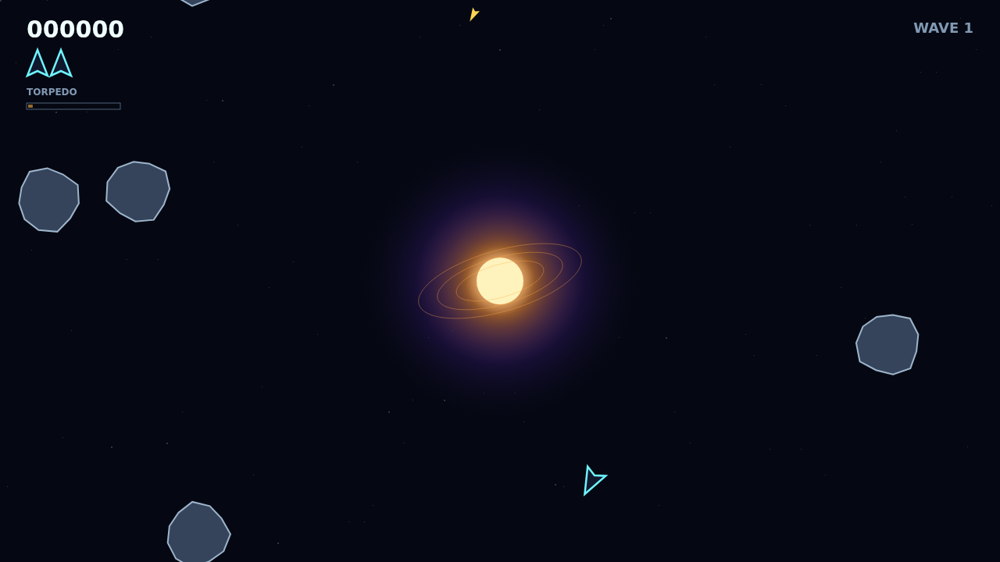
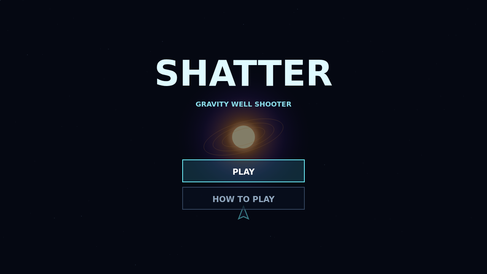

# Shatter

Shatter drops you into a wrapping field of deep space where every shot has to negotiate a hungry star. Your ship flies on pure momentum, but the gravity well bends bullets and rocks into sweeping arcs—turning a missed shot into a second chance on the far side of the core.

Large rocks carry armor and break into two generations of faster fragments. Clear every last shard to reach the next, denser wave, while the star recycles anything it swallows and an armed saucer periodically crosses the field to hunt you.

Your warhead is a single guided torpedo on a ten-second recharge. Point its narrow acquisition cone at the body you need gone: it flies straight through the well, homes on the nearest target ahead, and destroys any rock outright. Choosing when to spend it is often the difference between a clean escape and a shattered ship.

